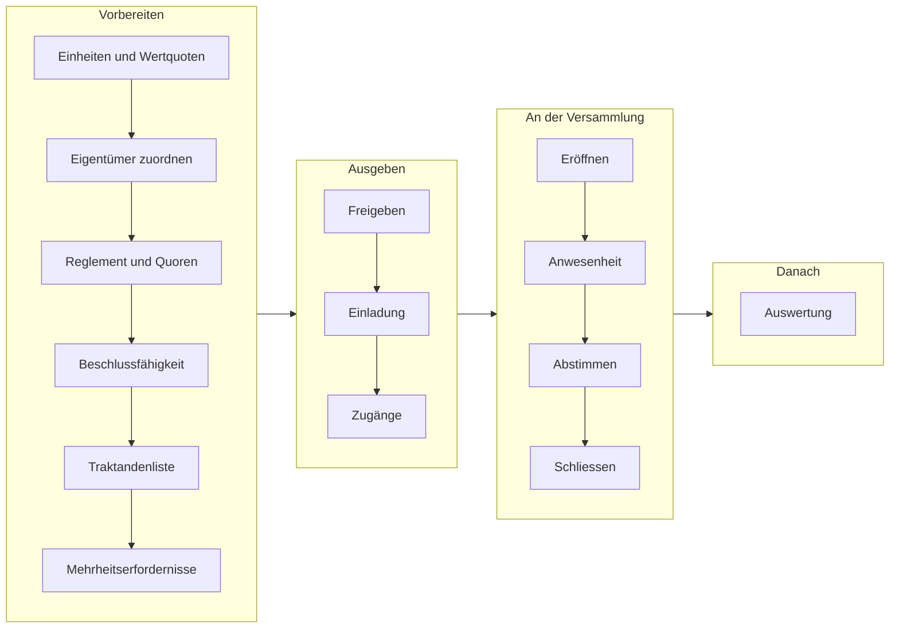

# Handbuch Votum

**Votum** führt eine Stockwerkeigentümerversammlung, statt sie nur zu
dokumentieren. Das Werkzeug bestimmt je Traktandum, welche Mehrheit nötig ist,
zählt Kopfstimmen und Wertquoten nach der Regel, die für diese Gemeinschaft
gilt, und hält jeden Schritt so fest, dass sich ein Beschluss später belegen
lässt.

Es ersetzt weder die Sitzungsleitung noch das Protokoll. Es schlägt vor; die
Sitzungsleitung entscheidet.

## Welches Kapitel Sie brauchen

| Sie wollen … | Lesen Sie |
|---|---|
| wissen, was ins Werkzeug gehört und wo es sperren darf | [Leitplanken](leitplanken.md) |
| die Anwendung aufsetzen, sichern, aktualisieren | [Installation](installation.md) |
| eine Seite bauen oder umbauen (Entwicklung) | [Gestaltung der Seiten](gestaltung.md) |
| Authentik, Dateiablage oder die KI anbinden | [Dienste einbinden](dienste.md) |
| eine Versammlung vorbereiten und führen | [Eine Versammlung führen](versammlung-fuehren.md) |
| mehrere Gemeinschaften an einem Abend führen | [Der Verbund](verbund.md) |

Wenn Sie zum ersten Mal mit dem Werkzeug arbeiten, lesen Sie
[Eine Versammlung führen](versammlung-fuehren.md) von vorn. Das Kapitel setzt
keine Vorkenntnisse voraus und erklärt die Fachbegriffe an der Stelle, an der
sie zum ersten Mal gebraucht werden.

## Der Weg durch eine Versammlung

Dieselben Schritte führt die Anwendung selbst: Jede Versammlung hat unter
**Vorbereitung** eine Liste dieser Schritte mit Zustand, Fortschritt und
Sperrgrund. Wo dieses Handbuch und der Bildschirm auseinandergehen, gilt der
Bildschirm.

## Die Freigabe ist die Trennlinie

Ein Datum im Ablauf trägt mehr Gewicht als alle anderen: die **Freigabe**. Bis
dahin sind Stammdaten und Traktanden beweglich. Mit der Freigabe friert das
Werkzeug fest, wer stimmberechtigt ist, wie er am Tag der Versammlung gilt.
Danach ändert eine Korrektur an den Stammdaten nichts mehr an dieser
Versammlung, und das ist beabsichtigt: Wer im August für den September einlädt,
lädt auf den Stand vom September ein.

Erst nach der Freigabe entstehen Einladung und Zugänge. Erst danach lässt sich
die Versammlung eröffnen.

## Was das Werkzeug noch nicht tut

Diese Punkte sind geplant, aber nicht gebaut. Rechnen Sie im Betrieb mit ihnen:

| Fehlt | Behelf heute |
|---|---|
| Eine Versammlung nachträglich hier anlegen | Wurde sie auf einem anderen Gerät geführt und dort versiegelt, nehmen Sie das **Abschlusspaket** auf: **Gemeinschaft → Versammlungen → Eine Versammlung von aussen aufnehmen**. Nachgebaut wird nichts — das Paket bleibt, wie es ist. |
| Nutzniessung aus immotool übernehmen | Kennt immotool nicht — hier erfassen unter **Gemeinschaft → Nutzniessung**. Alles Übrige holt **Gemeinschaft → Stammdaten übernehmen**, siehe [Dienste einbinden](dienste.md). |
| Anmeldung der Eigentümer über Authentik | Im Saal führt der Weg über die persönliche Zugangskarte, siehe [Dienste einbinden](dienste.md). |
| Kennwort in der Anwendung ändern | Über `scripts/benutzer-anlegen.mjs`, siehe [Installation](installation.md). |
| Jede Liste sortieren und filtern | Sortierbar sind Einheiten, Eigentümer und Personen; durchsuchbar Versammlungen, Eigentümer, Gemeinschaften, Personen und der Verlauf. Traktanden, Anwesenheit, Vollmachten und Auswertungen stehen in fester Reihenfolge — dort ist die Reihenfolge die Aussage. |

Nicht mehr in dieser Tabelle, weil gebaut: Protokoll als Word-,
OpenDocument- und PDF-Dokument, Vertretung und Vollmacht als eigener Vorgang, Abschlusspaket mit
Siegel und Zeitstempel, die KI-Prüfungen. Für die KI-Funktionen braucht es einen
eingerichteten Zugang — ohne ihn bleiben sie stumm, siehe
[Dienste einbinden](dienste.md).

## Die Startseite zeigt den Abend, nicht seine Häuser

Tagen mehrere Gemeinschaften an einem gemeinsamen Abend, steht auf der
Startseite **eine** Kachel: die des Abends, mit der Zahl der Gemeinschaften und
dem Weg in seine Sitzungsleitung.

Bis zum 25.08.2026 stand dort je eine Kachel pro Haus — beim Nirgendwerk die MEG
Umgebung **und** Nirgendweg 5/5a nebeneinander, mit demselben Datum, derselben
Zeit, demselben Ort. Das las sich wie zwei Sitzungen, die gleichzeitig zu führen
wären. Geführt wird eine: der Abend. Die Kopfzeile sagte das schon richtig, die
Kacheln nicht.

Der Fortschritt einer solchen Kachel ist der des **am wenigsten weiten** Hauses,
und der nächste Schritt ist dessen Schritt. Ein Mittelwert verspräche einen
Stand, den kein Haus hat.

## Stammdaten aus einer Datei übernehmen

Eigentümer und Einheiten lassen sich **aus Excel oder CSV** übernehmen, statt sie
einzeln zu erfassen. Der Weg steht auf der Eigentümerliste und auf der
Einheitenseite, jeweils unter «Mehrere auf einmal?».

Eine Datei je Art — eine für die Eigentümer, eine für die Einheiten — und beide
dürfen zusammen gewählt werden. Die Reihenfolge spielt keine Rolle: Das Werkzeug
erkennt an den Spalten, was was ist, und nimmt die Eigentümer zuerst, weil die
Einheiten auf sie verweisen.

**Excel wird gelesen, nicht in CSV umgewandelt.** Wer erst als CSV speichern
muss, wählt dabei Trennzeichen und Zeichensatz — genau die zwei Dinge, an denen
ein Import scheitert. Erkannt wird am Inhalt, nicht an der Endung: Wer eine CSV
in «liste.xlsx» umbenennt, bekommt trotzdem seine CSV gelesen.

Drei Dinge, die dabei zu wissen sind:

* **Gelesen wird das erste Blatt** — das, was im Programm zuvorderst steht.
* **Nur Werte.** Steht in einer Zelle eine Formel, zählt ihr letztes Ergebnis.
  Wurde die Datei nie in Excel geöffnet, gibt es keines, und die Zelle bleibt
  leer.
* **Datumsangaben** rechnet das Werkzeug zurück (Excel speichert sie als Zahl).
  Wer sichergehen will, formatiert die Spalte als Text und schreibt
  «JJJJ-MM-TT».

Vor dem Übernehmen zeigt das Werkzeug, **was geschehen würde** — je Zeile: neu,
geändert, unverändert oder fehlerhaft. Ginge die Wertquotensumme danach nicht
mehr auf, fragt es ein zweites Mal.

**Mehrere Personen an einer Einheit.** Nennt eine Eigentümerzeile unter
`person_names` zwei oder mehr Personen, entsteht eine Zeile
«Gemeinschaftliches Eigentum» und darunter je eine Zeile pro Person.

Die Einheit und damit die eine Stimme hält die gemeinschaftliche Zeile
(ZGB Art. 712o Abs. 1); die Einladung geht an alle einzeln (Wermelinger,
Rz. 50 ad Art. 712n). Wer die Stimme ausübt, steht in `legal_representatives`
und muss eine der genannten Personen sein. Eine Drittperson vertritt über eine
Vollmacht.

**Die Angabe ist freiwillig** (Produktentscheid 27.08.2026, Migration 096).
Fehlt sie, geht die Zeile trotzdem durch: Ist am Abend nur einer der
Mitberechtigten da, darf die Sitzungsleitung ihn zählen, auch ohne Vollmacht
(Wermelinger, Rz. 19 ad Art. 712o). Führt die Datei eine Personenliste, aber
keine Vertretung, fällt die Übernahme weiterhin auf die erstgenannte Person
zurück; ob dieser Rückfall bleiben soll, ist offen.

Hängen an einer Zeile schon Mitberechtigte, lässt eine spätere Übernahme sie
unangetastet. Weicht die Datei ab, steht das vor dem Übernehmen in der
Vorschau.

## Archivieren: da behalten, aus dem Weg räumen

Was einmal da war, blieb bis zum 25.08.2026 für immer in jeder Liste. Löschen
geht nur, solange nichts daran hängt — bei einer Versammlung nur im Entwurf,
bei einer Eigentümerzeile gar nicht mehr, sobald ein festgehaltener Stand oder eine
Weisung daran hängt. Das ist richtig so: Ein Nachweis darf nicht ins Leere
zeigen. Für alles andere gibt es jetzt das Archiv.

**Archivierbar sind vier Dinge:** Gemeinschaften, Versammlungen,
Eigentümerzeilen und Personen. Der Weg steht jeweils an ihrer eigenen Seite
unter «Archiv»; bei der Eigentümerzeile im Ausklapper der Zeile.

**Was sich ändert, ist genau eine Frage:** Erscheint der Gegenstand dort, wo man
**auswählt** und **sucht**?

| Verschwindet aus | Bleibt sichtbar in |
|---|---|
| Gemeinschaftsliste, Startseite, Elternwahl, MEG-Mitglieder, Zuordnung zum Abend, Versammlungsliste, Eigentümerliste, Personenauswahl | Verlauf, Protokoll, Auswertung, Siegelpaket, der Seite des Gegenstands selbst, dem Namen einer bestehenden Mitgliedschaft, dem Einlass |

Gelöscht wird **nichts**.

### Die Gruppe ist eine Einheit

**Wer eine Gemeinschaft archiviert, archiviert die ganze Gruppe** (Auftraggeber,
25.08.2026: «Gruppen müssen als gesamte Gruppe archiviert und wiederhergestellt
werden, weil diese zusammenhängen»). Eine Klammer nimmt ihre Häuser mit, die
Häuser ihre Versammlungen — und das Hervorholen bringt alles gemeinsam zurück.
Die Rückfrage nennt vorher, was mitgeht.

Zur Gruppe gehört der Baum «steht unter» (`parent_stweg_id`), **nicht** die
Mitgliedschaft in einer MEG. Die MEG Umgebung gehört den fünf Häusern, aber sie
enthält sie nicht: Die Häuser sind eigenständige Gemeinschaften mit eigenen
Versammlungen, und die MEG stillzulegen darf sie nicht mitnehmen.

Zwei Folgen, die dazugehören:

* **Ein Haus in einer archivierten Gruppe lässt sich nicht einzeln hervorholen.**
  Der Weg zurück steht an der Klammer; auf der Seite des Hauses steht, welche
  das ist.
* **Was vorher schon einzeln im Archiv lag, bleibt dort.** Wer ein Haus im
  Januar stilllegt und die Klammer im März, hat im April nach dem Hervorholen
  der Klammer alles zurück — bis auf dieses eine Haus.

Technisch steht `archived_at` deshalb nur auf **einer** Zeile: derjenigen, auf
der die Entscheidung fiel. Die Zugehörigkeit leitet sich beim Lesen ab
(`stweg_archiv_wegen`, Migration 087). Ein Teilbaum, dem man das Kennzeichen
aufschriebe, ginge auseinander — das Hervorholen wüsste nicht mehr, wen es
mitnehmen soll, und ein Haus, das man später unter einer archivierten Klammer
anlegt, stünde in der Liste, während seine Klammer im Archiv liegt.

### Die Regeln, die dabei gelten

**Archiviert wird, was versiegelt ist** (Auftraggeber, 25.08.2026). Jeder andere
Zustand wird abgewiesen, und die Meldung nennt je einen eigenen Weg heraus:

| Zustand | Warum nicht | Was stattdessen |
|---|---|---|
| Entwurf | ein Plan, kein Nachweis | entfernen — das Archiv ist kein Papierkorb |
| freigegeben | Einladungen sind draussen | eröffnen, die Beschlussunfähigkeit feststellen, schliessen und versiegeln; oder die Freigabe zurücknehmen (die Rücknahme nur, solange keine Vollmacht hängt) |
| läuft | die Versammlung tagt | schliessen |
| geschlossen | das Siegel fehlt | versiegeln — es ist der Nachweis, dass das Protokoll zu dem gehört, was im Saal geschah |

Auf der Seite einer geschlossenen Versammlung steht der Archivblock trotzdem —
mit dem Satz, was fehlt, und dem Weg zum Siegel. Ein Knopf, der kommentarlos
fehlt, ist keine Auskunft.

**Keine Gruppe ins Archiv, solange eine ihrer Versammlungen unterwegs ist.**
Die Regel darüber galt zuerst nur für die einzelne Versammlung und war über die
Gemeinschaft umgehbar: Wer die Klammer archivierte, nahm die laufende
Versammlung ihres Hauses mit aus der Startseite. Im Saal lief sie weiter.
Gesperrt sind dabei die laufende, die freigegebene und die geschlossene, aber
unversiegelte — **nicht** der Entwurf: Er ist ein Plan, und ein Haus mit drei
Terminentwürfen liesse sich sonst nie stilllegen, ohne sie vorher einzeln zu
löschen. Entwürfe gehen mit ins Archiv und kommen mit zurück.

**Und umgekehrt: Eine archivierte Versammlung lässt sich nicht freigeben.**
Sonst entstünde eine Versammlung, die freigegeben ist — Einladungen draussen,
Zugangscodes verteilt — und zugleich aus jeder Liste verschwunden. Holen Sie sie
zuerst hervor. Der Knopf dafür steht auf ihrer Seite in **jedem** Zustand; nur
das Hineinlegen ist an den Zustand gebunden.

**Wer noch mitzählt, wird nicht archiviert.** Eine Eigentümerzeile mit
zugeordneten Einheiten geht nicht — und eine Person nicht, solange eine ihrer
Zeilen Einheiten hält. Solange zählt die Stimme mit, und die Zeile gehört in die
Liste. Beenden Sie zuerst die Zuordnung (der Eigentumswechsel hat ein Datum).
Dasselbe von der anderen Seite: **Einer archivierten Zeile lässt sich keine
Einheit zuordnen** — sie steht im Auswahlfeld gar nicht mehr.

**Archivieren ändert keine Zahl.** Die Stimmkraft, der festgehaltene Stand und jedes
Ergebnis rechnen unverändert weiter. Das ist der Grund für die Regel darüber:
Was rechnet, wird nicht gefiltert.

**Und wer archiviert, wird trotzdem eingelassen.** Am Einlass zählt die
der festgehaltene Stand, nicht die Liste: Eine archivierte Person steht in «Ohne Karte
einlassen» weiterhin zur Wahl. Alles andere hiesse, jemanden an der Tür
abzuweisen, dessen Stimme drinnen mitzählt.

### Archivieren oder löschen?

**Archivieren räumt aus dem Weg, löschen macht weg.** Was je an einer
Versammlung teilgenommen hat, lässt sich nicht mehr löschen — ein Protokoll darf
nicht ins Leere zeigen. Für alles andere gilt:

| | Archivieren | Löschen |
|---|---|---|
| Eigentümerzeile (in *einer* Gemeinschaft) | solange ihr keine Einheit zugeordnet ist | nur wenn nichts daran hängt: keine Zuordnung (auch keine beendete), keine Teilnahme an einer Versammlung, keine Weisung, kein Traktandum |
| Person (über alle Gemeinschaften) | solange keine ihrer Zeilen Einheiten hält | dieselben Schranken, angewandt auf **jede** ihrer Zeilen |
| Versammlung | nur die versiegelte | nur im Entwurf |
| Gemeinschaft | wenn keine ihrer Versammlungen unterwegs ist | nur solange nichts daran hängt |

**Beim Löschen einer Person gehen ihre leeren Eigentümerzeilen mit.** Das ist
keine Bequemlichkeit, sondern nötig: Solange eine Zeile auf die Person zeigt,
weist die Datenbank das Löschen ab (`party.person_id` steht auf `RESTRICT`), und
wer «Person erfassen» benutzt, legt Person und Zeile in einem Zug an. Die
Rückfrage nennt die Zeilen mit ihrer Gemeinschaft.

Der Unterschied zum Archivieren ist Absicht: Dort zählt nur die **heute**
laufende Zuordnung — Archivieren nimmt nichts weg und darf grosszügiger sein.
Beim Löschen zählt **jede** Zuordnung, auch die längst beendete: Sie ist Teil
der Eigentümergeschichte.

### Filtern ist eine Entscheidung, keine Vorgabe

Jeder Leseweg, den das Archiv betrifft, verlangt die Sicht als **Pflichtangabe**
(`'aktiv'` oder `'alle'`) — der Übersetzer weist einen Aufruf ohne sie ab. Die
Faustregel dahinter: **Auswahllisten filtern, Nachschlagen und Prüfungen nie.**

Eine Vorgabe stand hier einen halben Tag lang und traf dreimal das Falsche: Die
Elternauswahl verlor die archivierte Klammer und löste beim nächsten Speichern
das Haus aus der MEG; die Doppelprüfung beim Anlegen sah die archivierte
Erstversammlung nicht mehr; der Einlass verlor die archivierte Person.
`scripts/check-archivsicht.mjs` hält fest, dass die Vorgabe nicht zurückkommt.

### Der Schalter statt einer Archivseite

In jeder betroffenen Liste steht neben der Suche **«Archivierte anzeigen»** —
und nur dort, wo es überhaupt etwas Archiviertes gibt. Eine eigene Archivseite
wäre eine zweite Liste mit eigener Suche und eigener Sortierung; sie liefe
auseinander, und man müsste erst wissen, dass es sie gibt.

Die eine Lücke eines Schalters schliesst die Leerstelle: Wer sucht und nichts
findet, liest **«Im Archiv liegen 2 Gemeinschaften, die dazu passen»** mit dem
Schalter daneben. Gezählt wird dabei mit **derselben** Suche wie in der Liste —
ein zweiter Suchbegriff ergäbe eine Zahl, die zum Schalter nicht passt.

Ist der Schalter an, trägt jede archivierte Zeile die Marke **«archiviert»** —
sonst stünden archivierte und aktive Zeilen ununterscheidbar nebeneinander.

## Was das Werkzeug bewusst nicht tut

Ein Punkt gehört nicht in die Tabelle darüber, weil er keine Lücke ist, sondern
eine Grenze: **Über ein nicht angekündigtes Geschäft lässt das Werkzeug nur dann
abstimmen, wenn das Reglement es ausdrücklich gestattet oder die Versammlung als
Universalversammlung tagt** (ZGB Art. 67 Abs. 3 i.V.m. Art. 712m Abs. 2;
SVIT-Kommentar Rz. 39 und 84 ad Art. 712n). Beide Angaben stehen auf der
Reglementsseite der Gemeinschaft und gelten, wie sie bei der Freigabe der
Einladung standen. Geschützt ist, wer nicht da ist und auf die Traktandenliste
vertraut hat. Bei der Universalversammlung müssen alle Eigentümer nach der
Einstellung da sein, die Leitung bestätigt, dass niemand widerspricht, und geht
jemand ohne Stimme oder widerspricht nach dem Eröffnen, entsteht «kein
Beschluss». Bis zum
29.09.2026 stand hier, auch mit Zustimmung aller Anwesenden sei es nie zulässig;
das Gesetz enthält dieses Verbot nicht.

Ohne diese Angabe bleiben im Saal zwei Wege offen: der **Folgeantrag** zu einem angekündigten
Antrag, in dessen Kern die Sache liegt, und die **Kenntnisnahme** heute mit dem
Beschluss an der nächsten Versammlung. Siehe
[Eine Versammlung führen](versammlung-fuehren.md).

## Ein Vorbehalt, der nicht übergangen werden darf

Die ausgelieferte Fassung des Regelwerks ist **nicht juristisch gegengelesen**.
Jedes Ergebnis weist darauf hin. Der Vorschlag des Werkzeugs ersetzt die
rechtliche Einschätzung der Sitzungsleitung nicht, und im Streitfall zählt, was
die Versammlung beschlossen hat, nicht was das Werkzeug vorgeschlagen hat.
